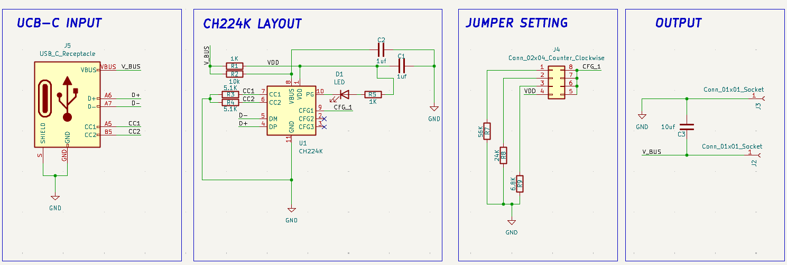
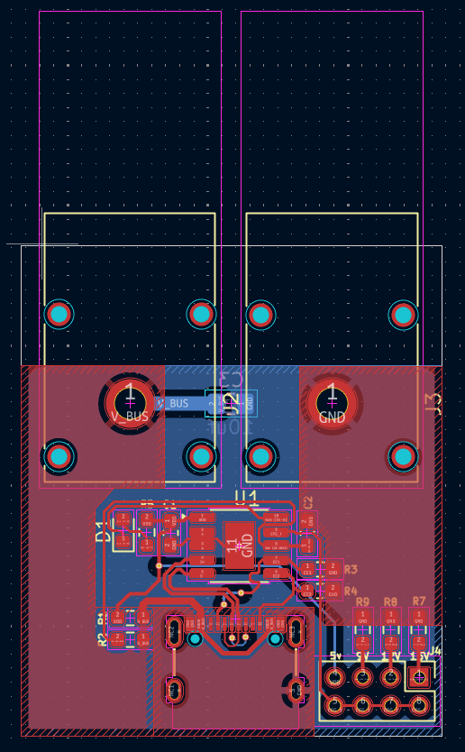
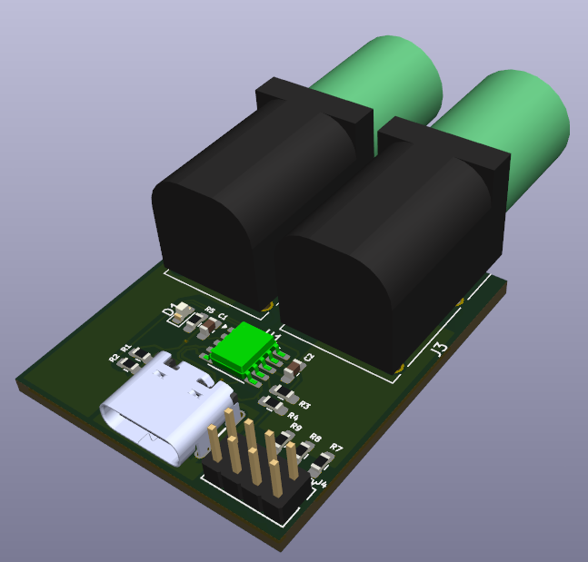

# 01_Kicad_USB-C_PD_Controller
Autonomous USB-C PD trigger board using the WCH CH224K. It requests 5/9/12/15/20 V from a PD charger and outputs it on 4 mm banana jacks. Designed in KiCad.

# USB-C PD Trigger Board (CH224K)

A compact, MCU-free USB Power Delivery trigger board. The CH224K negotiates the requested voltage (5, 9, 12, 15 or 20 V) with a PD charger, and the board outputs it on 4 mm banana jacks for use as a simple bench supply. A jumper header on the CFG1 pin selects the voltage, and a status LED on the PG pin shows when negotiation has succeeded.

**Controller:** WCH CH224K (ESSOP-10), configured by resistor or level selection
**Input:** USB-C receptacle
**Output:** 4 mm banana jacks (VBUS/GND)
**Tools:** KiCad, 2-layer PCB, targeted at JLCPCB fabrication

**Status:** Design stage Completed. The schematic and layout are drawn complete but not yet fabricated or tested physically. 

**Roadmap:** V2 will add an STM32 and OLED display for MCU-controlled voltage selection.

**Libraries used:**
1) kicad default - most of the packages.
2) sparkfun - USB type C receptacle (needs to be installed via kicad's plugin & library manager).

# Schematics Capture

# PCB Design

# 3D Model
